# GPS vélo

Compteur GPS vélo fait maison, avec les fonctions utiles des Garmin, Wahoo et COROS : enregistrement FIT pour Strava, trace GPX, profil des montées type ClimbPro avec noms de cols, écrans tactiles.

## État (octobre 2026)

Le code commun est écrit et testé **sur ordinateur**. Rien n'a encore tourné sur le matériel.

| Module | Rôle |
|---|---|
| `core/route` | Lecture d'un GPX en flux (sans allocation), mise à pas constant de 10 m |
| `core/matcher` | Position GPS sur la trace : distance depuis le départ, hors parcours, reprise après perte du signal |
| `core/climb` | Détection des montées, catégories (barème Garmin), pente par sections, valeurs restantes |
| `core/cols` | Noms des montées à partir d'une base locale de cols et de lieux (OpenStreetMap) |
| `core/fit` | Enregistrement d'une sortie au format FIT, avec récupération d'un fichier interrompu |
| `core/alerts` | Alertes : hors parcours, batterie faible puis critique, fréquence cardiaque trop élevée, signal GPS perdu, ceinture perdue, montée proche. Délais anti-fausse-alerte, rappels, priorités, acquittement |
| `sim` | Simulateur sur ordinateur : une fenêtre avec l'appareil (souris = doigt) et un tableau de commandes pour rejouer une sortie et provoquer des pannes (`docs/simulateur.md`) |
| `ui` | Application LVGL 9 en portrait 320 x 480 : pages mises à jour en direct, page de montée qui s'ouvre seule, fenêtre de fin de montée, champs personnalisables (appui long), bannières d'alerte, réglages d'alertes (appui long sur la barre d'état), navigation tactile. Simulée sur PC |

À faire : projet ESP-IDF pour la carte, acquisition GNSS, ceinture cardio (BLE), carte SD, envoi à Strava, fond de carte hors ligne, son et vibration pour les alertes (l'action `alert` est prête), alertes de zones de fréquence cardiaque détaillées. Détails dans `docs/avancement.md`.

## Matériel visé

Waveshare ESP32-S3-Touch-LCD-3.5 (écran tactile 3,5 pouces 320 x 480, 8 Mo de PSRAM), module GNSS u-blox MAX-M10S, baromètre I2C, batterie LiPo. Notes vérifiées sur la carte : `docs/carte_waveshare.md`.

## Structure

    core/    code C commun, sans dépendance (testé sur PC, destiné à ESP-IDF)
    ui/      écrans LVGL 9, polices avec accents, aperçu sur PC (build_preview.sh)
    tests/   tests sur PC, génération des données de rejeu
    tools/   convertisseur d'export OpenStreetMap vers la base de cols
    docs/    notes, captures d'écran

## Lancer les tests

Il faut gcc, make et python3 (avec `garmin-fit-sdk` et `fitdecode` pour la vérification des fichiers FIT : `pip install garmin-fit-sdk fitdecode`).
Place un GPX de test, avec heures et fréquence cardiaque, dans `tests/data/sortie.gpx`, puis :

    make test          # alertes, montées, noms, positionnement, enregistrement FIT
    make nommage       # facultatif : noms avec une vraie base dans tests/data/gps.csv
    make sim GPX=sortie.gpx COLS=gps.csv   # simulateur interactif (SDL2 requis, voir docs/simulateur.md)
    make ui            # simule une sortie : ouverture automatique de la page de montée, fenêtre de fin, toucher (télécharge LVGL 9.2.2)

## Aperçu des écrans

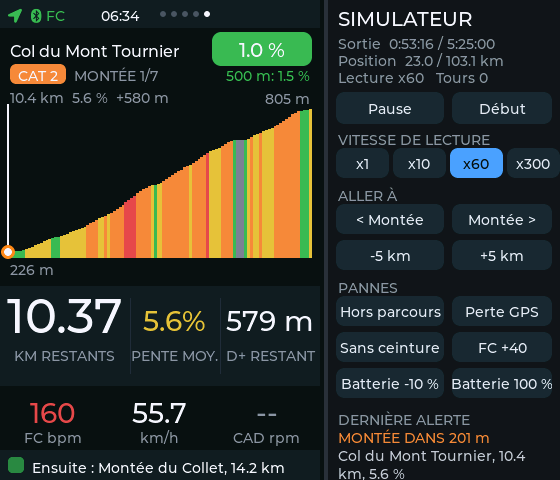

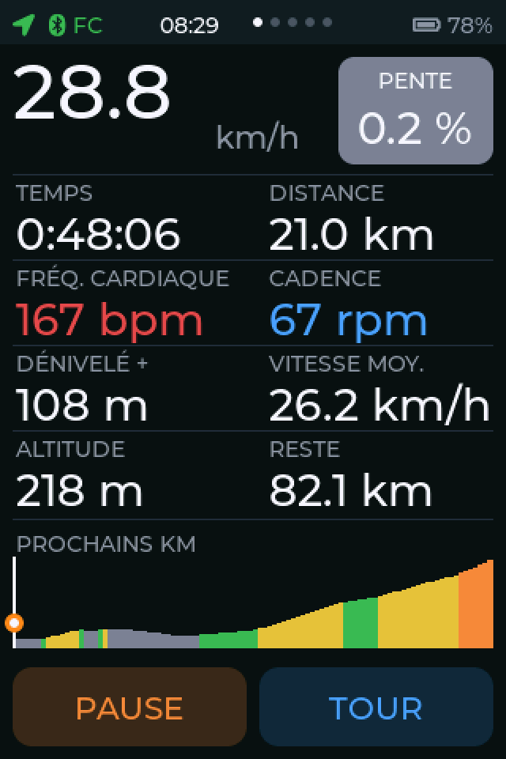 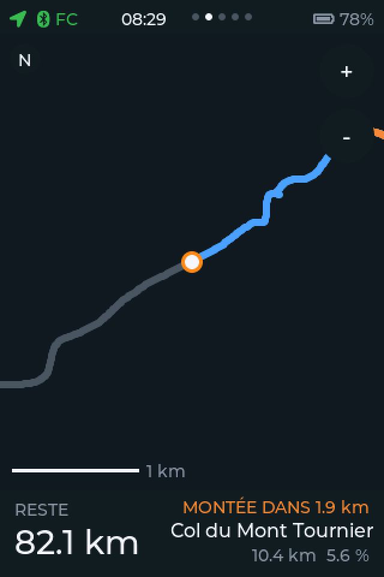 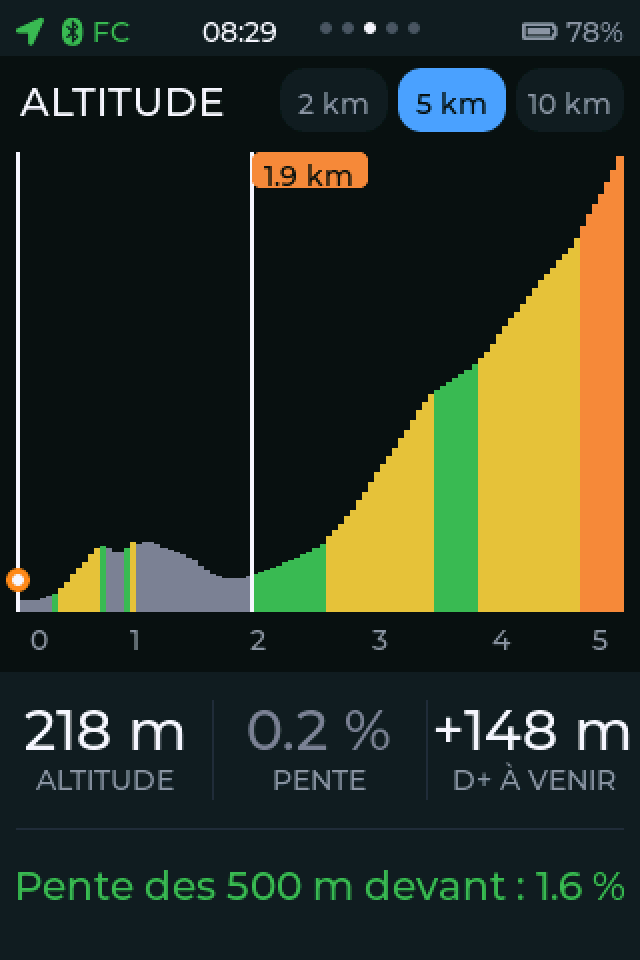 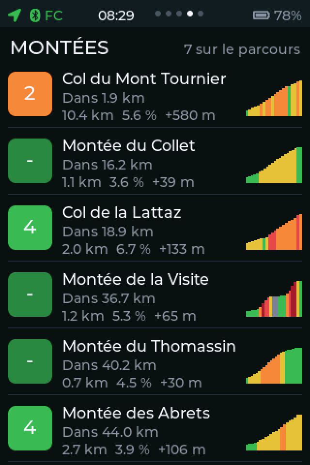 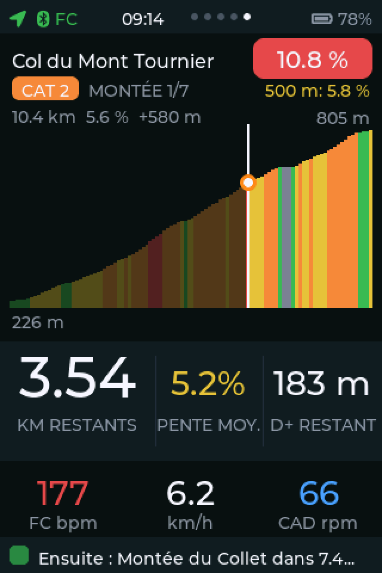 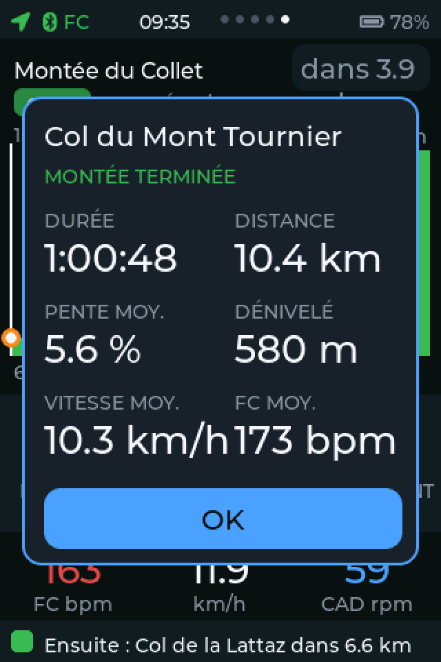 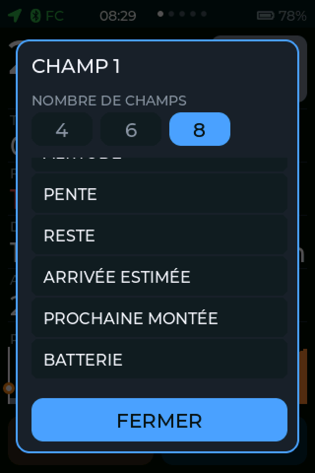 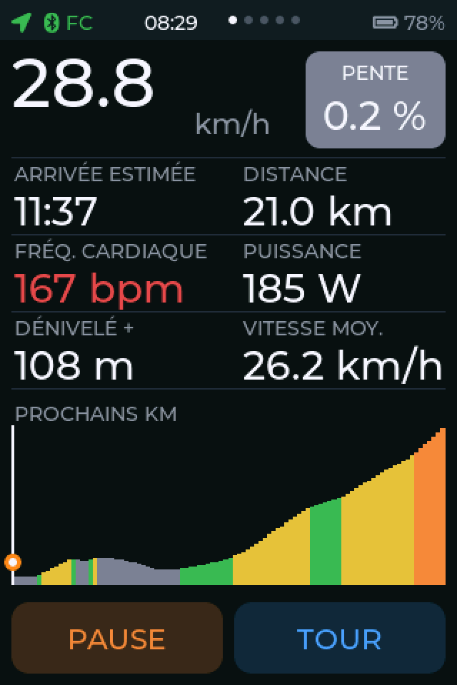 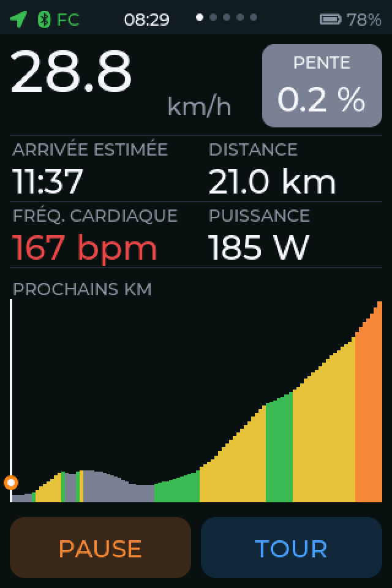 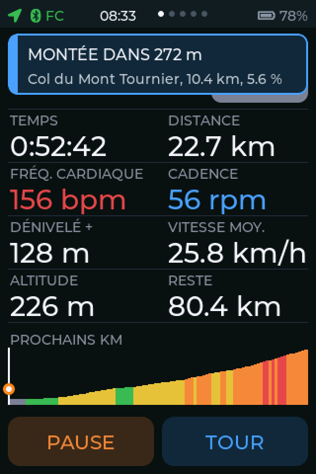 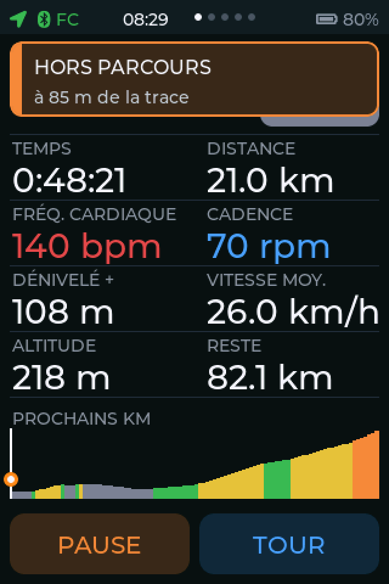 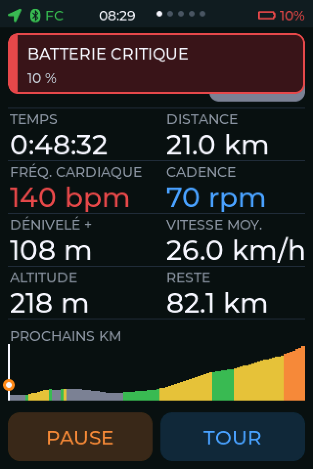 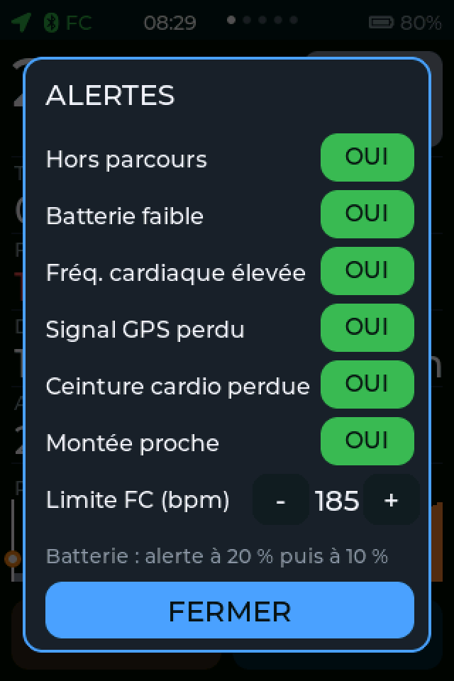

## Données personnelles

Le dépôt ne doit contenir **ni trace GPS ni fichier d'activité** : une sortie commence et finit souvent chez soi. Le `.gitignore` exclut `*.gpx` et `*.fit`. Les tests lisent un GPX fourni localement dans `tests/data/` (non publié).

## Licences et crédits

- Licence du code : à choisir.
- LVGL (interface) : voir son dépôt. Les polices de `ui/fonts` sont générées à partir de Montserrat (licence SIL OFL, à rappeler dans le dépôt).
- Données de cols et de lieux : © les contributeurs d'OpenStreetMap, licence ODbL. Le crédit doit apparaître dans l'appareil ou sa documentation.
- Le code n'est pas copié d'autres projets : les algorithmes de montées et de catégories s'appuient sur la documentation publique de Garmin et sur la lecture d'autres projets libres.
