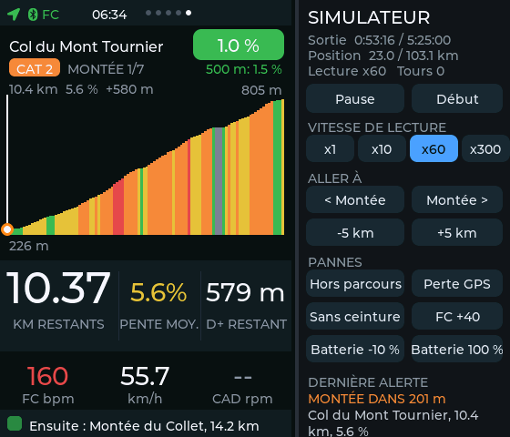
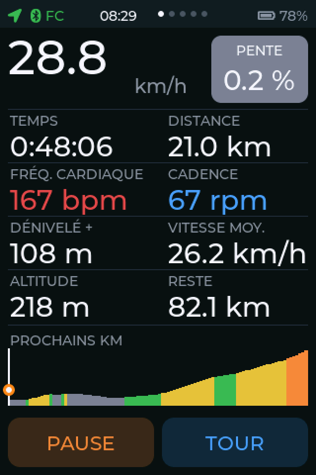
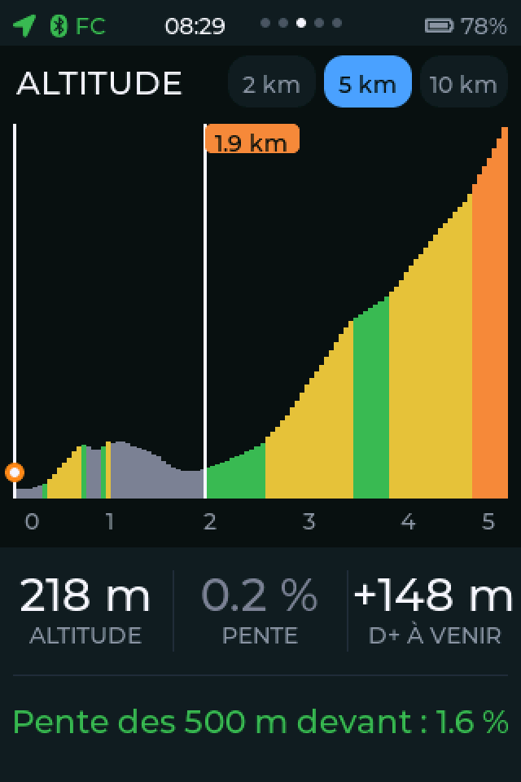
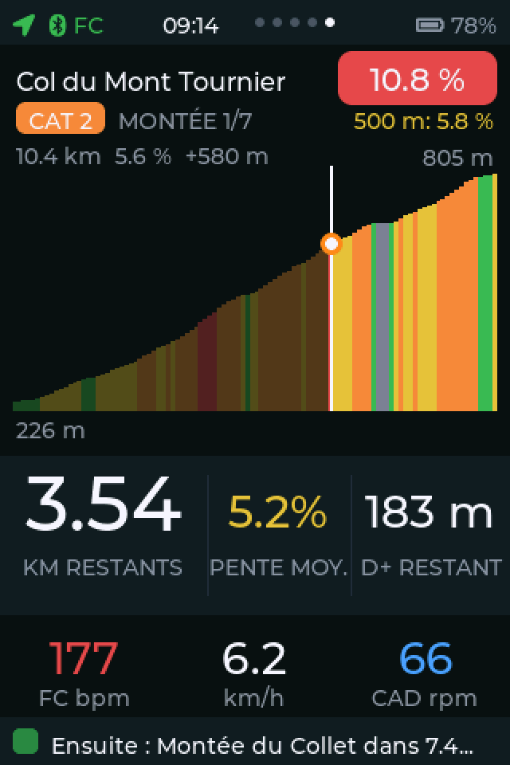
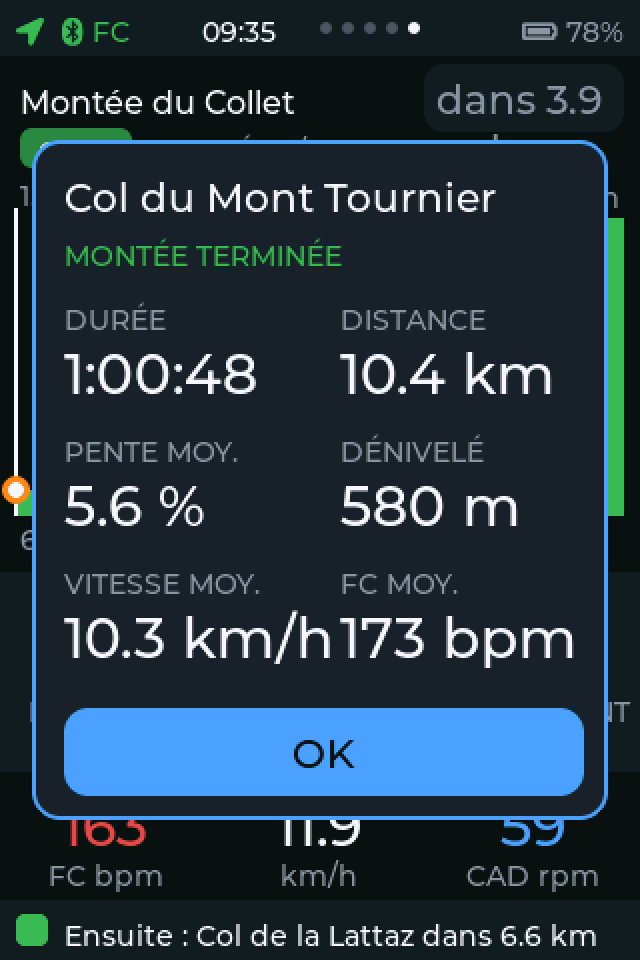

# GPS vélo (gps-cyclo)

Compteur GPS vélo fait maison, avec les fonctions utiles des Garmin, Wahoo et COROS : enregistrement FIT pour Strava, trace GPX, profil des montées type ClimbPro avec noms de cols, carte hors ligne, écran tactile.

## État en bref

Le code commun est écrit et des tests existent pour la plupart des modules. Rien n'a encore tourné sur le matériel, et les tests n'ont pas été rejoués lors du dernier audit.

Quatre niveaux de preuve sont distingués partout dans la documentation : codé, test présent (non rejoué), rejoué, validé sur matériel. Le détail par fonctionnalité est dans [docs/ETAT_DU_PROJET.md](docs/ETAT_DU_PROJET.md).

## Matériel visé

Carte Waveshare ESP32-S3-Touch-LCD-3.5 (écran tactile 3,5 pouces 320 x 480, 8 Mo de PSRAM), module GNSS u-blox MAX-M10S, baromètre I2C, batterie LiPo. Détails et points de vigilance : [docs/MATERIEL.md](docs/MATERIEL.md).

## Structure du dépôt

    core/    code C commun, sans dépendance (testé sur PC, destiné à ESP-IDF)
    ui/      écrans LVGL 9, polices avec accents, aperçu sur PC
    sim/     simulateur sur PC (SDL2)
    tools/   scripts Python : conversion OpenStreetMap, base de cols, export Strava
    tests/   tests sur PC et génération des données de rejeu
    docs/    notes techniques et captures d'écran

## Lancer les tests

Prérequis : gcc, make, python3, et `pip install garmin-fit-sdk fitdecode` pour la vérification des fichiers FIT.

Placez un GPX de test, avec heures et fréquence cardiaque, dans `tests/data/sortie.gpx` (ce fichier n'est jamais versionné), puis :

    make test          # alertes, montées, noms, positionnement, enregistrement FIT
    make nommage       # facultatif : noms avec une vraie base dans tests/data/gps.csv
    make sim GPX=sortie.gpx COLS=gps.csv   # simulateur interactif (SDL2 requis)
    make ui            # simulation d'une sortie (télécharge LVGL 9.2.2)

La procédure complète, y compris les tests de carte, est dans [docs/ARCHITECTURE.md](docs/ARCHITECTURE.md) et `docs/simulateur.md`.

## Documentation

| Document | Contenu |
|---|---|
| [docs/CAHIER_DES_CHARGES.md](docs/CAHIER_DES_CHARGES.md) | Ce que l'appareil doit faire |
| [docs/ETAT_DU_PROJET.md](docs/ETAT_DU_PROJET.md) | Où en est chaque fonctionnalité, problèmes connus |
| [docs/ARCHITECTURE.md](docs/ARCHITECTURE.md) | Modules, formats de données, compilation et tests |
| [docs/ROADMAP.md](docs/ROADMAP.md) | Prochaines étapes, par ordre de priorité |
| [docs/MATERIEL.md](docs/MATERIEL.md) | Carte, composants, contraintes électriques |
| [docs/DECISIONS.md](docs/DECISIONS.md) | Décisions techniques datées |
| [CLAUDE.md](CLAUDE.md) | Instructions pour l'assistant de développement |

## Aperçu des écrans

     

## Données personnelles

Le dépôt ne doit contenir ni trace GPS ni fichier d'activité : une sortie commence et finit souvent chez soi. Les fichiers personnels (GPX, FIT, `gps.csv`, jetons Strava) restent en local.

Statut de la protection : l'exclusion de `*.gpx` et `*.fit` par le `.gitignore` était annoncée par l'ancien README, mais elle n'a pas été vérifiée, ni dans le fichier ni dans l'historique Git. Cette vérification est obligatoire avant toute publication (voir `docs/DECISIONS.md`, D04).
