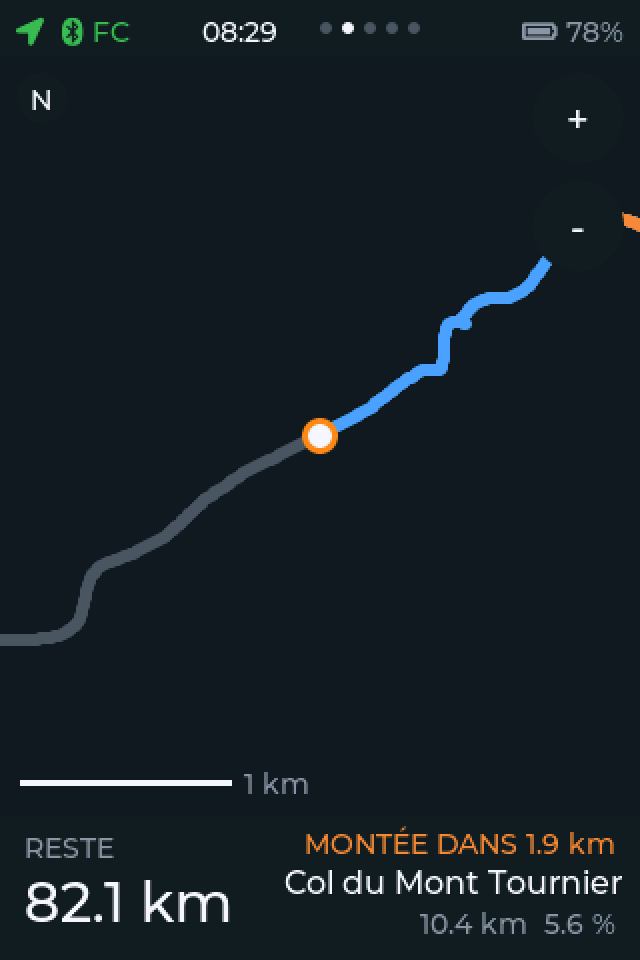
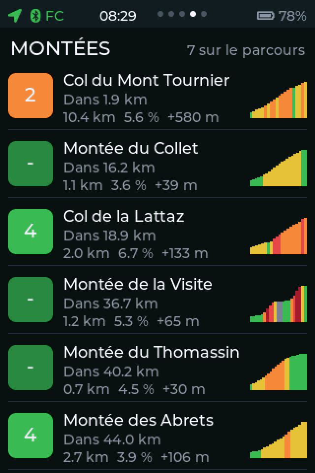

# GPS vélo (gps-cyclo)

Compteur GPS vélo fait maison, avec les fonctions utiles des Garmin, Wahoo et COROS : enregistrement FIT pour Strava, trace GPX, profil des montées type ClimbPro avec noms de cols, carte hors ligne, écran tactile.

## État en bref

Le code commun est écrit et testé sur ordinateur. Rien n'a encore tourné sur le matériel. `make test` s'appuie sur un jeu de test fictif : il a été rejoué en entier dans un bac à sable Linux (21 novembre 2026) puis sur le Mac de Nicolas (22 novembre 2026), voir [docs/TESTS.md](docs/TESTS.md).

Quatre niveaux de preuve sont distingués partout dans la documentation : codé, test présent (non rejoué), rejoué, validé sur matériel. Le détail par fonctionnalité est dans [docs/ETAT_DU_PROJET.md](docs/ETAT_DU_PROJET.md).

## Matériel visé

Carte Waveshare ESP32-S3-Touch-LCD-3.5 (écran tactile 3,5 pouces 320 x 480, 8 Mo de PSRAM), module GNSS u-blox MAX-M10S, baromètre I2C, batterie LiPo. Détails et points de vigilance : [docs/MATERIEL.md](docs/MATERIEL.md).

## Structure du dépôt

    core/    code C commun, sans dépendance (testé sur PC, destiné à ESP-IDF)
    ui/      écrans LVGL 9, polices avec accents, aperçu sur PC
    sim/     simulateur sur PC (SDL2)
    tools/   scripts Python : conversion des cartes depuis OSM PBF, base de cols, export Strava
    tests/   tests sur PC et génération des données de rejeu
    docs/    notes techniques et captures d'écran

## Lancer les tests

Prérequis : gcc, make, python3, et `pip install garmin-fit-sdk fitdecode` pour la vérification des fichiers FIT (sans eux, `make test` s'arrête à `verify_fit.py` avec une erreur Python).

`make test` n'exige aucun fichier personnel : il génère un jeu fictif dans `tests/data/synthetique/` (sortie de 66 km en plein Atlantique, 5 montées, base de cols fabriquée). Les cibles `make nommage` et `make ui` utilisent votre propre GPX, placé dans `tests/data/sortie.gpx`, et `make nommage` votre base `tests/data/gps.csv` (ces fichiers sont exclus par le `.gitignore`).

    make test          # alertes, montées, noms, positionnement, enregistrement FIT (jeu fictif)
    make nommage       # facultatif : noms avec une vraie base dans tests/data/gps.csv
    make sim GPX=sortie.gpx COLS=gps.csv   # simulateur : votre sortie (avec heures) et votre vraie base de cols (SDL2 requis)
    make ui            # simulation d'une sortie (télécharge LVGL 9.2.2)

La procédure complète, y compris les tests de carte, est dans [docs/ARCHITECTURE.md](docs/ARCHITECTURE.md), [docs/TESTS.md](docs/TESTS.md) et `docs/simulateur.md`.

## Documentation

| Document | Contenu |
|---|---|
| [docs/CAHIER_DES_CHARGES.md](docs/CAHIER_DES_CHARGES.md) | Ce que l'appareil doit faire |
| [docs/ETAT_DU_PROJET.md](docs/ETAT_DU_PROJET.md) | Où en est chaque fonctionnalité, problèmes connus |
| [docs/ARCHITECTURE.md](docs/ARCHITECTURE.md) | Modules, formats de données, compilation et tests |
| [docs/ROADMAP.md](docs/ROADMAP.md) | Prochaines étapes, par ordre de priorité |
| [docs/MATERIEL.md](docs/MATERIEL.md) | Carte, composants, contraintes électriques |
| [docs/DECISIONS.md](docs/DECISIONS.md) | Décisions techniques datées |
| [docs/TESTS.md](docs/TESTS.md) | Commandes de test, résultats rejoués avec date, commit et environnement |
| [docs/BUGS_CONNUS.md](docs/BUGS_CONNUS.md) | Bugs et défauts connus, avec preuve |
| [docs/HISTORIQUE.md](docs/HISTORIQUE.md) | Chronologie du projet |
| [CLAUDE.md](CLAUDE.md) | Instructions pour l'assistant de développement |

## Aperçu des écrans

     

## Données personnelles

Le dépôt ne doit contenir ni trace GPS ni fichier d'activité : une sortie commence et finit souvent chez soi. Les fichiers personnels (GPX, FIT, TCX, `gps.csv`, jetons Strava) restent en local.

Le `.gitignore` exclut `*.gpx`, `*.fit`, `*.tcx`, `*.csv`, `*.pbf`, `build/`, `.env`, `__pycache__/`, `.aider*` et `sim/lvgl/`. Il ne protège pas un fichier déjà suivi par Git, ni un dossier envoyé à la main par l'interface web : vérifier son contenu avant chaque envoi. Le détail de la vérification faite le 19 novembre 2026 est dans `docs/DECISIONS.md` (D04).
