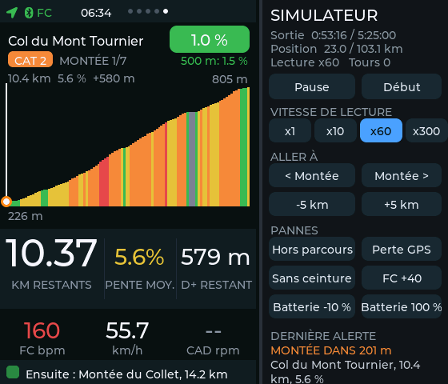

# Simulateur sur ordinateur

Le simulateur ouvre une fenêtre avec l'appareil à gauche (la souris joue le rôle du doigt) et un tableau de commandes à droite. Il rejoue une sortie enregistrée devant le GPS : positionnement sur la trace, montées, noms de cols, alertes, enregistrement des champs, tout fonctionne comme sur l'appareil, sauf le matériel (GPS réel, Bluetooth, batterie, son).

## Installation (Mac)
1. Outils de développement : `xcode-select --install` (donne le compilateur et git).
2. Bibliothèque d'affichage : `brew install sdl2` (Homebrew : https://brew.sh si la commande `brew` n'existe pas).

## Lancer
Dans le dossier du dépôt :

    make sim GPX=~/Desktop/sortie.gpx COLS=~/Desktop/gps.csv CARTE=~/Documents/carte.gvt

- `GPX` : le parcours prévu. S'il contient des heures (une sortie enregistrée), il est aussi rejoué.
- `RIDE=autre.gpx` : pour rejouer une autre sortie sur ce parcours (elle doit contenir des heures).
- `COLS` : la base de cols pour nommer les montées (facultatif). Au démarrage, le simulateur affiche combien d'entrées il a lues et signale un format non reconnu (voir `docs/cols.md`).
- `CARTE` : un fond de carte (`.gvt`, voir `docs/carte.md`) affiché sur la page trace. Le simulateur indique quelle part du parcours la carte couvre.
- `OPTS=--zoom 2` : fenêtre deux fois plus grande (écrans Retina).

La première fois, la compilation prend une à deux minutes (elle télécharge et compile LVGL). Ensuite le lancement est immédiat.

## Les commandes du tableau
- **Pause / Lecture, Début** : la lecture de la sortie.
- **x1, x10, x60, x300** : vitesse de lecture. x60 fait défiler une minute de sortie par seconde.
- **< Montée, Montée >** : saute à 500 m avant la montée précédente ou suivante. C'est le moyen le plus rapide d'essayer la page de montée.
- **-5 km, +5 km** : saute sur le parcours.
- **Pannes** : *Hors parcours* (la position est décalée de 150 m), *Perte GPS*, *Sans ceinture*, *FC +40* (pour dépasser la limite de fréquence cardiaque), *Batterie -10 %*, *Batterie 100 %*. Les boutons orange sont les pannes actives.
- **Dernière alerte** : ce que le boîtier signalerait par un bip.

Sur l'appareil : glisser à gauche ou à droite change de page, appui long sur un champ pour le changer, appui long sur la barre d'état pour régler les alertes, toucher une bannière pour l'acquitter.

## Ce qui est vérifié
Le moteur de rejeu est testé (`make test`). Le simulateur complet (fenêtre, clics de souris réels, ouverture automatique de la page de montée, fenêtre de fin, bannières d'alerte) est vérifié par un autotest (`sh sim/build_sim.sh sortie.gpx cols.csv --selftest`), exécuté sous Linux avec le pilote vidéo factice de SDL. **Il n'a pas encore été essayé sur macOS** : si la compilation ou la fenêtre pose problème, envoie le message d'erreur.

## Limites
- Les positions rejouées sont celles enregistrées, sans bruit de GPS réel.
- La vitesse de rendu sur ton Mac ne dit rien de celle de l'écran de la carte.
- Le son et la vibration ne sont pas simulés : le simulateur affiche la dernière alerte.
- Il n'y a pas encore de fond de carte.

## Dépannage
- *SDL2 est absent* : `brew install sdl2`.
- *Sortie illisible* : le GPX doit contenir des heures (`<time>`) pour être rejoué.
- Fenêtre trop grande ou trop petite : `OPTS=--zoom 1` ou `--zoom 2`.
